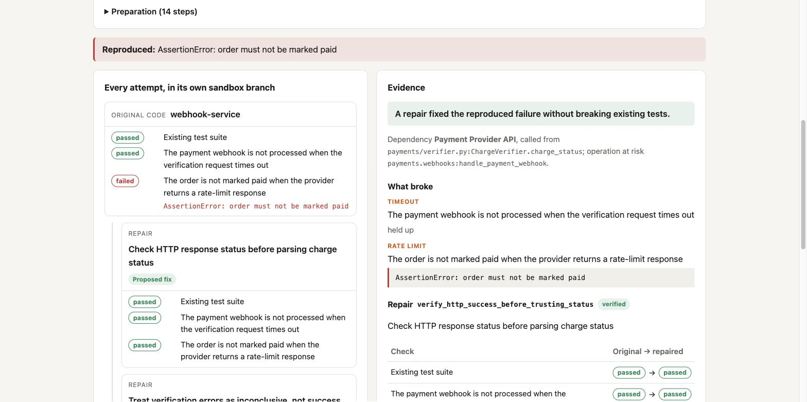
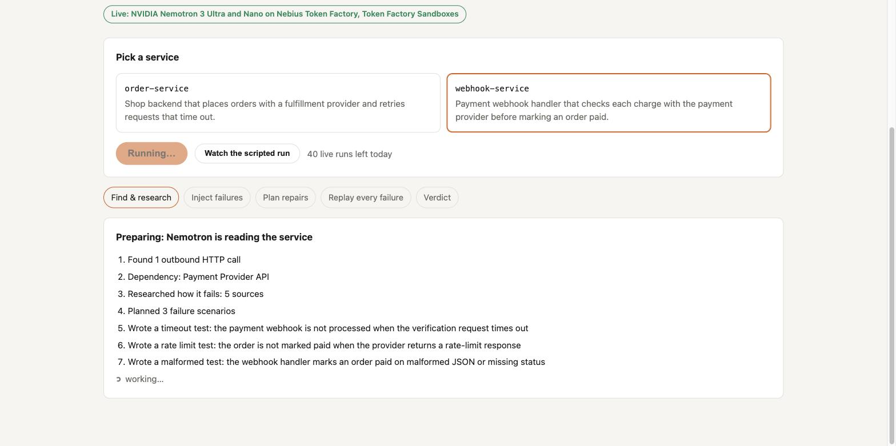
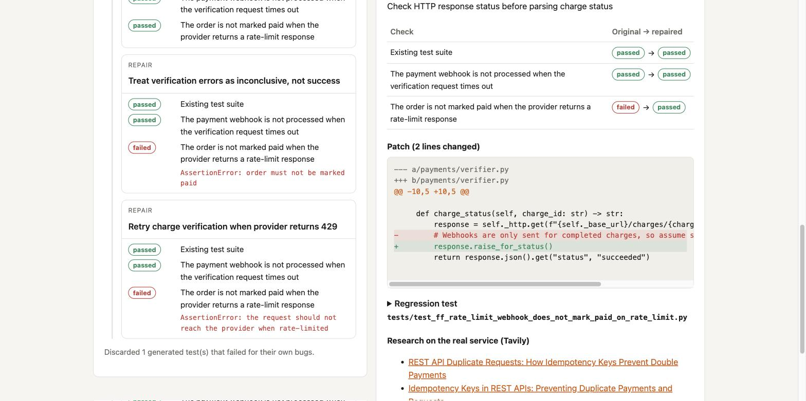

# FaultForge

**Find out how your application fails when its dependencies misbehave — and get a repair tested against those failures.**

Most outages in small backends are not bugs in the code you read every day. They happen when a dependency is slow, rate-limits you, answers with garbage, or delivers the same request twice — and the code that handles those cases has never run. FaultForge makes those cases run.

Point it at a small Python service. It finds the outbound HTTP dependency, researches how that service really fails, writes executable failure tests, runs each one in its own sandbox branch, generates competing repairs for what broke, and replays **every** failure against **every** repair before proposing a pull request with the evidence.

Built for the Nebius x NVIDIA Global AI Hackathon — Coding & Agentic Engineering track.



<sub>A live run on the webhook service (Nemotron 3 Ultra + Nano on Token Factory, Token Factory Sandboxes, 5 Oct 2026): the rate-limit failure is reproduced, three repairs are tried in parallel branches, and the one that checks the HTTP status is verified.</sub>

| While Nemotron reads the service | The proven patch |
|---|---|
|  |  |

## What it finds

| Example | What the code does | What actually happens under the fault |
|---|---|---|
| `order-service` | Retries a fulfillment request that timed out | The provider had already accepted the first one: **one order, two shipments** |
| `webhook-service` | Checks the charge before marking an order paid | A 429 answer has no `status`, which the code defaults to `"succeeded"`: **unpaid order marked paid** |
| [`hook-slinger`](https://github.com/rednafi/hook-slinger) (third-party, unchanged) | Delivers webhooks with retries | Retries and duplicates carry no idempotency key: **the receiver processes the same webhook twice** |

Both services' own test suites pass. FaultForge's evidence for the first one:

| Check | Original → repaired |
|---|---|
| Existing test suite | passed → passed |
| Provider accepts the order but the response times out | **failed → passed** |

```diff
             timeout=5.0,
+            headers={"Idempotency-Key": order_id},
```

A competing repair — "stop retrying" — is rejected because the failure still reproduces.

## How it works

```mermaid
flowchart LR
    A[Repo + operation] --> B[Find httpx call sites<br/>static scan]
    B --> C[Name dependency & operation at risk<br/>Nemotron 3 Ultra]
    C --> D[Research real failure behaviour<br/>Tavily]
    D --> E[Write failure tests from 4 templates<br/>Nemotron 3 Nano]
    E --> F[Baseline: run each test in its own<br/>sandbox branch]
    F -->|reproduced| G[Plan distinct repairs<br/>Ultra → write each with Nano]
    G --> H[Replay every failure × every repair<br/>in parallel sandbox branches]
    H --> I[Rank by evidence → PR with patch,<br/>regression test and report]
```



- **Faults are injected inside the HTTP client** (an `httpx` transport), so a timeout is instant and deterministic — no sleeps, no network, no flaky tests. Four fault types: timeout after the dependency processed the request, rate limit with `Retry-After`, malformed (truncated) response, duplicate delivery.
- **Generated tests must fail for the right reason.** A test that errors, or fails with `NameError`/`ImportError`, proves nothing and is discarded.
- **Repairs may not touch tests or the fault kit.** A repair is accepted only if the existing suite still passes, no scenario regresses, and at least one reproduced failure is fixed. Ties go to the smaller diff.

## How Nemotron and Nebius Token Factory are used

| Step | Model / service | Why |
|---|---|---|
| Dependency analysis, scenario planning, repair strategies | **NVIDIA Nemotron 3 Ultra** (`nvidia/Nemotron-3-Ultra-550b-a55b`) on Token Factory | Reasoning over the whole codebase: what is the dependency, which operation is at risk, which distinct fixes are worth trying |
| Writing failure tests and patches | **NVIDIA Nemotron 3 Nano** (`nvidia/NVIDIA-Nemotron-3-Nano-30B-A3B`) on Token Factory | Fast, cheap generation of many candidates |
| Reviewing reproduced failures and second attempts | **Nemotron 3 Ultra**, reasoning on | Triage ("application bug or test mistake?") and revising a repair or test that failed verification |
| Running every check | **Token Factory Sandboxes** (Contree) | Each run of an image yields a new image, so the baseline, every scenario and every repair are branches of one checkpoint — exactly the shape of "replay every failure against every repair" |
| Research | **Tavily** | How the real dependency documents timeouts, rate limits and idempotency, cited in the report |

Nemotron models are region-scoped on Token Factory, so FaultForge keeps one OpenAI-compatible client per role (`faultforge/llm/token_factory.py`). Model output is consumed as JSON and validated; malformed output is retried once.

> **Status (2026-10-04):** the full loop runs live on Nemotron 3 Ultra and Nano via Token Factory, with Tavily research — from the CLI and from the web UI. In the latest batch, 6 of 8 live runs produced a genuine, verified repair; see [`docs/live-runs.md`](docs/live-runs.md) for every iteration and what it taught us. Since 2026-10-05 it also runs fully on **Token Factory Sandboxes** (`--sandbox contree`): every scenario and every repair is a branch of one sandbox checkpoint.

## Try it

**[Recorded live runs on Hugging Face](https://realramy-faultforge.static.hf.space/)**: the real UI
replaying three runs recorded on 5–6 October 2026 (Nemotron 3 Ultra + Nano on Token Factory, every
test and repair in Token Factory Sandboxes). **Hugging Face only hosts the static page:** it makes
no model calls, and no NVIDIA model is ever called through Hugging Face. All Nemotron calls go to
Nebius Token Factory. Run it live with the instructions below.

## Quick start (offline, no keys)

```bash
uv sync
uv run faultforge demo                              # order-service
uv run faultforge demo --example webhook-service
uv run faultforge demo --pr-preview                 # show the PR it would open
```

Web UI:

```bash
cd web && npm ci && npm run build && cd ..
uv run uvicorn faultforge.api:create_app --factory --port 8000
# open http://127.0.0.1:8000
```

Or with Docker: `docker build -t faultforge . && docker run -p 8000:8000 faultforge`.

Deploying behind a reverse proxy or load balancer: set `FAULTFORGE_TRUST_PROXY=1` so each visitor
is rate-limited separately (by the address the proxy appends to `X-Forwarded-For`). Leave it unset
when the app is reached directly, or clients could spoof the header.

## Live mode (Nemotron + Sandboxes + Tavily)

```bash
cp .env.example .env      # NEBIUS_API_KEY, NEBIUS_PROJECT_ID, TAVILY_API_KEY
uv run --extra contree --env-file .env faultforge run examples/order-service --sandbox contree
```

Live mode executes Nemotron-written code, so it refuses the local sandbox unless you opt in.
Until Sandboxes access is enabled, run it inside the container instead:

```bash
docker run --rm --env-file .env -e FAULTFORGE_ALLOW_LOCAL_LIVE=1 faultforge \
  uv run --no-sync faultforge run examples/order-service
```

Without `--scenario`, FaultForge discovers the dependency, researches it and writes the scenarios itself. With `--open-pr` it commits the repair and regression test on a new branch of the target repo and opens a GitHub pull request.

## Safety

FaultForge executes model-written code, so:

- Live mode refuses to run in the local sandbox unless explicitly overridden; use Token Factory Sandboxes (VM-isolated).
- The local sandbox gets an allowlisted environment — API keys never reach executed code.
- Patches outside the repo, and edits to tests or the fault kit, are refused.
- The hosted demo runs prepared examples only, rate-limits each client (HTTP 429 with `Retry-After`), caps active runs, and only previews pull requests.

## Project layout

```
faultforge/
  faultkit/      the four faults as an httpx transport (copied into the code under test)
  discovery.py   static httpx call-site scan + Ultra analysis
  research.py    Tavily lookup of documented failure behaviour
  scenarios.py   templates, generation, "fails for the right reason" filter
  repair.py      plan strategies (Ultra) → write patches (Nano), with validation
  replay.py      scenarios × candidates matrix, scoring
  sandbox/       contract, local implementation, Token Factory Sandboxes adapter
  llm/           contract, offline stub, Token Factory client
  pipeline.py    reproduce → repair → replay
  api.py         FastAPI + server-sent events; demo limits
  pr.py          pull request with patch, regression test and evidence
web/             React UI: live attempt tree and evidence view
examples/        example services with realistic hidden failures
```

## Tests

```bash
uv run pytest            # 165 tests, offline (plus 16 UI tests: cd web && npm test)
uv run ruff check .
cd web && npm test       # UI model and components
```

## Prior art

Fault injection and chaos engineering are well established (Gremlin, Toxiproxy and others). FaultForge does not claim to have invented them; its contribution is the integrated loop for small teams — reproduce the failure in the code, generate competing repairs, and prove each one against the same failures before anyone reviews a patch.

## Licence

MIT — see [LICENSE](LICENSE).
